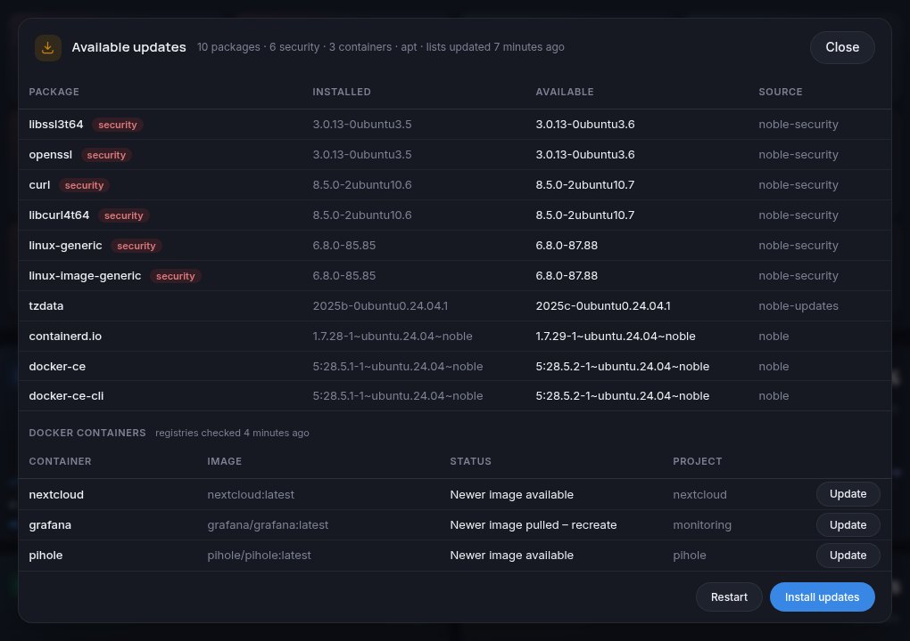
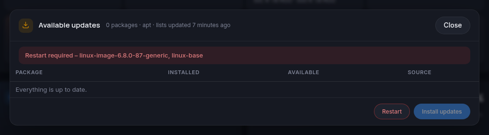

# Kongo

A live stats page for a Linux server, in the style of Windows Task Manager. It runs as one small Docker container. It updates every second over a WebSocket and loads nothing from external sites.


- **System:** OS, kernel, CPU and temperature, memory, disks, network, private and public IP, gateway and running containers
- **Package updates:** a badge next to the host name shows how many updates are available and whether a restart is needed. Click it to see the list, and to install the updates or restart the server with the password of a Linux admin user. Works with apt (Debian, Ubuntu), dnf (Fedora, RHEL, Rocky, Alma), zypper (openSUSE), pacman (Arch) and apk (Alpine).
- **Container updates:** click the Docker row in the System panel to see every running container and whether its image has a newer version, in the registry or already pulled but not in use yet. The badge counts them too, and with the admin buttons on you can update them from there. Containers with a web UI get an **Open** button that opens it in a new tab.
- **Meters:** CPU, Memory, Disk Read, Disk Write, Network In and Network Out, each with a 60-second graph
- **Filesystems:** size, used, available and use % for each mount, like `duf`
- **Network by container:** traffic for each Docker network namespace
- **Processes:** a sortable, filterable list grouped by name, with CPU, 60-second average CPU, memory and disk I/O
- Light and dark mode



## Run it

You need a Linux host with Docker and Docker Compose. The image [`bassidus/kongo`](https://hub.docker.com/r/bassidus/kongo) is built for amd64 and arm64.

```sh
mkdir kongo && cd kongo
curl -fsSLO https://raw.githubusercontent.com/bassidus/kongo/main/docker-compose.yml
echo "TZ=Europe/London" > .env   # optional, your timezone (default UTC)
docker compose up -d
```

Then open `http://<your-server>:8090`. To update it later, run `docker compose pull && docker compose up -d`.

To build it yourself instead, clone the repo and run `docker compose up -d --build`.

### Settings

You can set these in `docker-compose.yml` or `.env`:

| Variable | Default | Meaning |
|---|---|---|
| `TZ` | `Etc/UTC` | Timezone for the times on the page |
| `PORT` | `8090` | Port the page is served on |
| `NET_IFACES` | *(empty)* | NICs to count, comma-separated. Empty means all physical NICs. |
| `PUBLIC_IP_URL` | `https://api.ipify.org` | Service used to look up the public IP every 30 min. Set it to an empty value to turn the lookup off. |
| `UPDATES_REFRESH_HOURS` | `12` | Refresh the host's package lists when they are older than this. `0` means Kongo only reads them. |
| `CONTAINER_UPDATES_HOURS` | `12` | Ask the registries this often whether running containers' images have newer versions. `0` turns the container check off. |
| `ADMIN_ACTIONS` | `off` (`on` in `docker-compose.yml`) | Show the **Install updates** and **Restart** buttons. Needs a host with systemd. |

### Why the container needs host access

Kongo shows the host, not the container, so `docker-compose.yml` gives it:

- `network_mode: host` and `pid: host`, to see the real network counters and every process
- `SYS_PTRACE` and `apparmor:unconfined`, to read the disk I/O of each process
- read-only mounts of `/etc/passwd` and `/etc/group` for user names, and of `/var/lib/docker/containers` for container names

To list package updates, Kongo runs the host's own package manager in a chroot as the user `nobody`, so the check can read the package state but not change it.

The list is only as fresh as the host's repository lists. When they are older than `UPDATES_REFRESH_HOURS` (default 12), Kongo refreshes them with the host's own command, as root: `apt-get update`, `dnf makecache`, `zypper refresh` or `apk update`. This is what the distributions' own timers (`apt-daily`, `dnf-makecache`) do, so if those keep the lists fresh, Kongo never needs to. It only refreshes the lists and never installs or removes packages. Set `UPDATES_REFRESH_HOURS=0` and Kongo only reads.

Arch is different: syncing pacman's own databases without upgrading leads to partial upgrades. Kongo therefore syncs a private copy in `/var/cache/kongo/pacman`, as `checkupdates` does, and leaves the host's databases alone. On zypper, pacman and apk the list does not mark security updates.

The page has no login. It cannot stop processes, and everything except the two buttons below is read-only. Keep it on your LAN, or put it behind a reverse proxy that requires a login.

For container updates, Kongo reads the host's Docker through its socket (via `/proc/1/root`, so no extra volume) and asks each image's registry which digest the tag points at now. These are `HEAD` requests, which don't count against Docker Hub's pull limit. Images built locally, and images pinned to a digest, are not checked. Only the root Docker daemon's containers are covered, not those of rootless Docker.

### Install updates and Restart

With `ADMIN_ACTIONS=on`, the updates popup has two buttons. Each asks for a password, which Kongo checks against the host's `/etc/shadow`. When more than one user on the host qualifies, it also has a menu to pick the user. With none, there are no buttons. Only `root` and members of `sudo`, `wheel` or `admin` are accepted. After 5 wrong passwords in 15 minutes the buttons are locked for 15 minutes.

- **Install updates** runs the package manager without questions, for example `apt-get update` and then `apt-get -y --with-new-pkgs upgrade`. Changed config files are kept, and services are not restarted. It runs as a systemd unit on the host (`kongo-upgrade`), not in the container. An update of Docker itself restarts the Kongo container, but the upgrade carries on; the popup shows its log and picks it up again when Kongo is back.
- **Update** (next to each container with a newer image, in the updates popup and the Docker row's popup) and **Update all** run, for each compose project involved, `docker compose pull` for those services and then `docker compose up -d`, in the project's folder. Compose then recreates only the containers whose image changed. Containers started with plain `docker run` are left alone, because their options can't be recreated from what Docker keeps.
- **Restart** reboots the host after 3 seconds.

When an update needs a restart, for example a new kernel, the badge says **Restart required** and the popup names the packages that asked for it:



**The page has no TLS, so the password crosses the network in clear text.** Only turn this on for a LAN you trust, or put Kongo behind an HTTPS reverse proxy. Set `ADMIN_ACTIONS=off` to remove the buttons.
