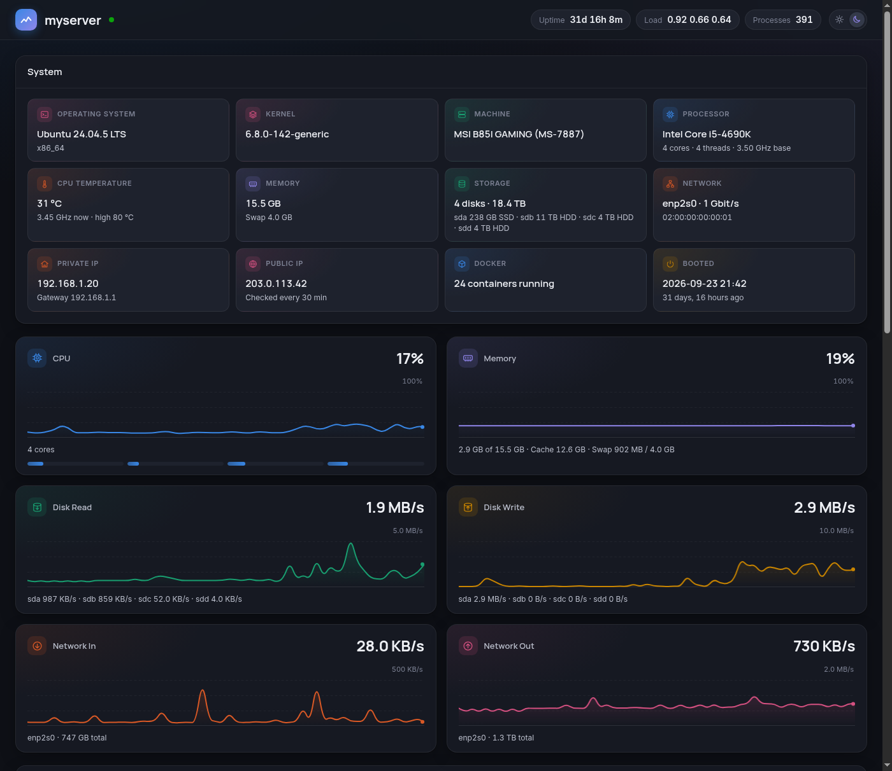

# Kongo

A live stats page for a Linux server, in the style of Windows Task Manager. It runs as one small Docker container. It updates every second over a WebSocket and loads nothing from external sites.



- **System:** OS, kernel, CPU and temperature, memory, disks, network, private and public IP, running containers and boot time
- **Meters:** CPU, Memory, Disk Read, Disk Write, Network In and Network Out, each with a 60-second graph
- **Filesystems:** size, used, available and use % for each mount, like `duf`
- **Network by container:** traffic for each Docker network namespace
- **Processes:** a sortable, filterable list grouped by name, with CPU, 60-second average CPU, memory and disk I/O
- Light and dark mode

## Run it

You need a Linux host with Docker and Docker Compose.

```sh
git clone https://github.com/bassidus/kongo.git
cd kongo
echo "TZ=Europe/London" > .env   # optional, your timezone (default UTC)
docker compose up -d --build
```

Then open `http://<your-server>:8090`.

### Settings

You can set these in `docker-compose.yml` or `.env`:

| Variable | Default | Meaning |
|---|---|---|
| `TZ` | `Etc/UTC` | Timezone for the times on the page |
| `PORT` | `8090` | Port the page is served on |
| `NET_IFACES` | *(empty)* | NICs to count, comma-separated. Empty means all physical NICs. |
| `PUBLIC_IP_URL` | `https://api.ipify.org` | Service used to look up the public IP every 30 min. Set it to an empty value to turn the lookup off. |

### Why the container needs host access

Kongo shows the host, not the container, so `docker-compose.yml` gives it:

- `network_mode: host` and `pid: host`, to see the real network counters and every process
- `SYS_PTRACE` and `apparmor:unconfined`, to read the disk I/O of each process
- read-only mounts of `/etc/passwd` and `/etc/group` for user names, and of `/var/lib/docker/containers` for container names

The page has no login and is read-only. It cannot stop processes. Keep it on your LAN, or put it behind a reverse proxy that requires a login.
